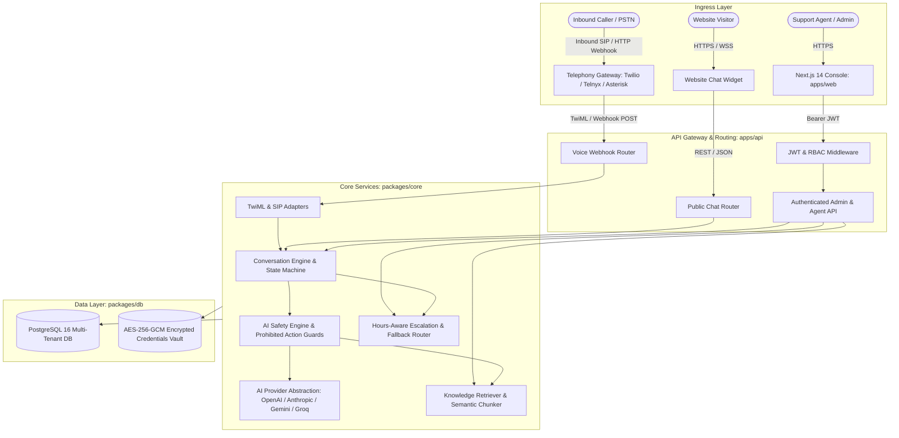
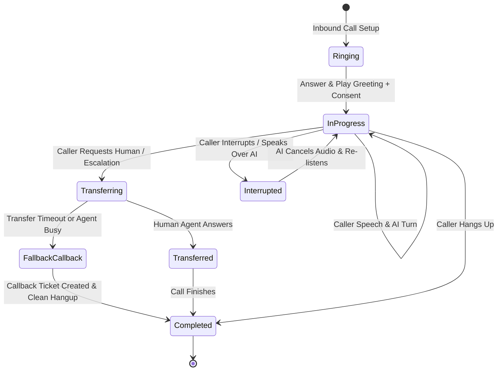

# Platform Architecture & Technical Design

This document details the architectural design, component topology, multi-tenant isolation, data flow, cryptographic security, and extension points of the open-source AI customer-service platform.

---

## 1. System Topology & Data Flow

---

## 2. Inbound Voice Call Lifecycle State Machine

---

## 3. Core Component Responsibilities

### 1. `packages/db` (Data Layer)
- **Schema Management**: Typed Drizzle ORM definitions for 13 multi-tenant tables.
- **Cascade Deletion**: All tenant-scoped entities feature `ON DELETE CASCADE` referencing `tenants.id`.
- **Database Engine Abstraction**: Supports production PostgreSQL 16 via `node-postgres` (`pg`) and offline in-memory testing via WebAssembly `@electric-sql/pglite`.

### 2. `packages/core` (Domain Logic)
- **Conversation State Machine**: Strictly validates state transitions (`active` -> `waiting_agent` -> `transferred` -> `closed`), preventing illegal state jumps.
- **AI Abstraction Layer**: Standardized `AiProvider` interface with deterministic mock provider and production adapters for OpenAI, Anthropic, Google Gemini, and Groq. Handles error classification (`AiRateLimitError`, `AiAuthError`, `AiTimeoutError`, `AiContextLengthError`).
- **Business Knowledge Base**: Semantic Markdown/text chunker with token bounds and BM25 search with source attribution.
- **Safety Engine**: Pre-flight prompt injection scanner, isolated XML delimiter context wrapping, and hardcoded prohibited tool guards (`issue_refund`, `modify_policy`, `execute_shell_command`).
- **Telephony & Speech Adapters**: XML-safe TwiML generation, Asterisk/FreeSWITCH SIP normalization, `SpeechPipeline` (Deepgram Nova-2 STT & ElevenLabs Flash TTS), and offline `VoiceCallSimulator`.
- **Escalation, Operating Hours & ACD Queues**: Timezone-aware schedule evaluator with E.164 number validation, automatic fallback callback ticketing, and `CallQueueManager` for multi-tier skills-based routing with longest-idle agent distribution.
- **Omnichannel SMS Messaging**: `SmsAdapter` and `SmsConversationHandler` processing multi-turn SMS dialog with prompt defense and knowledge retrieval.
- **Post-Call Analytics & CSAT**: `ConversationAnalyzer` extracting multi-turn sentiment, CSAT scores (1–5), resolution flags, compliance verification (AI disclosure & recording notice), and AI summaries.
- **Usage Metering & Billing Engine**: `UsageMeter` tracking voice minutes and AI token consumption across tiers (`Starter`, `Pro`, `Enterprise`) with overage calculations.

### 3. `apps/api` (REST & Webhook Server)
- Express.js application exposing port `3001`.
- Webhooks: `/api/v1/voice/inbound`, `/api/v1/voice/events`, `/api/v1/voice/transfer-status`, `/api/v1/sms/inbound`.
- Chat API: `/api/v1/chat/public/session`, `/api/v1/chat/public/message`.
- Admin API: `/api/v1/admin/conversations`, `/api/v1/admin/knowledge`, `/api/v1/admin/integrations`.
- Privacy & Retention: `/api/v1/privacy/purge-retention`, `/api/v1/privacy/export-data`.

### 4. `apps/web` (Operator & Agent Console)
- Next.js 14 App Router application with Tailwind CSS and Lucide icons.
- Pages: `/overview`, `/conversations`, `/knowledge`, `/calls`, `/simulator`, `/settings`, `/integrations`, `/login`, `/chat-widget`.

---

## 4. Multi-Tenant Isolation Architecture

The platform enforces strict multi-tenancy at multiple layers:

1. **Foreign Key Scope**: Every tenant-owned record contains a `tenant_id` foreign key.
2. **Server-Side Token Verification**: The `requireTenantRole` middleware validates that the authenticated JWT user possesses a legitimate membership in `tenant_memberships` for the target tenant.
3. **Query Scoping**: Database queries unconditionally include `eq(table.tenantId, tenantId)`. Queries that attempt to access or modify resources belonging to another tenant yield `403 Forbidden` or `null`.
4. **Knowledge Isolation**: Knowledge retrieval queries filter chunks strictly by `tenant_id`, guaranteeing zero cross-contamination of proprietary corporate information.

---

## 5. Cryptography & Key Management Strategy

### Authenticated Zero-Knowledge BYOK Encryption
- **Algorithm**: `AES-256-GCM` (Galois/Counter Mode).
- **Key Derivation**: SHA-256 hash of `ENCRYPTION_MASTER_KEY` ensuring a 256-bit binary cipher key.
- **Initialization Vector**: 12-byte cryptographically secure pseudorandom IV (`crypto.randomBytes(12)`) generated per encryption operation.
- **Authentication Tag**: 16-byte GCM authentication tag. Decryption verifies the tag; any tampering with ciphertext or tag immediately throws an authentication error.

### Master Key Rotation Strategy
1. Stored integration credentials contain a `key_version` integer in `integration_credentials`.
2. When rotating keys:
   - Provide `ENCRYPTION_MASTER_KEY_V1` and `ENCRYPTION_MASTER_KEY_V2`.
   - Run the re-encryption utility: iterates records where `key_version = 1`, decrypts using V1, re-encrypts using V2, and updates the record with `key_version = 2`.
   - Once all records are migrated, V1 is retired.

---

## 6. Extension Points

The architecture is designed for modular extensibility:

1. **Custom AI Models & Local LLMs**:
   Implement the `AiProvider` interface (`chatComplete()`, `streamChat()`, `getCapabilities()`) to connect local Ollama, vLLM, or Hugging Face instances.
2. **Additional Telephony Providers**:
   Implement standard webhook adapters for Telnyx, Plivo, Bandwidth, or Kamailio SIP proxies following the `TwimlAdapter` and `SipAdapter` patterns.
3. **CRM & Ticketing Integrations**:
   The `EscalationEngine` emits structured `callback_request` events that can be easily dispatched to external ticketing systems (Salesforce, Zendesk, HubSpot) via webhooks.
4. **Omnichannel Messaging**:
   The `ConversationEngine` is channel-agnostic. Inbound channels (SMS, WhatsApp, Email) ingest messages and dispatch replies by invoking `ConversationManager.handleMessage()` with the appropriate `channel` tag.
5. **Real-Time Agent Copilot & Supervisor Assist**:
   `AgentCopilot` processes live conversational turns, extracts sentiment indicators, alerts supervisors on high-severity events, and generates AI-grounded reply suggestions and wrap-up dispositions.
6. **Automated Knowledge Ingestion Pipeline**:
   Connectors (`WebCrawlerConnector`, `DocumentParserConnector`, `ZendeskHelpCenterConnector`) ingest HTML, CSV tables, multi-page PDFs, and Zendesk articles into normalized Markdown for semantic retrieval.
7. **Outbound Notification Campaigns & DNC**:
   `OutboundCampaignManager` enforces TCPA calling hours (`CallingHoursGuard`) and Do-Not-Call compliance (`DncRegistry`) across proactive SMS and voice broadcast campaigns.
8. **Enterprise Identity (SSO & SCIM 2.0)**:
   `SsoManager` supports SAML 2.0 assertions and OIDC ID tokens with directory group-to-role mapping, while `ScimProvisioner` implements RFC 7644 user provisioning and lifecycle synchronization.
9. **Visual Call Flow & Interactive IVR Engine**:
   `FlowEngine` executes Directed Acyclic Graph (DAG) call flows across step types (`greeting`, `menu`, `condition`, `sub_flow`, `agent_transfer`, `ai_agent`, `hangup`) linked to the visual flow canvas at `/flows`.
10. **Live WebRTC Audio Bridge & Supervisor Coaching**:
    `AudioBridge` enables supervisory intervention in active calls via three non-destructive modes: `silent_monitor` (eavesdrop), `whisper` (coach agent privately), and `barge_in` (three-way conference).
11. **Multi-Agent Department Orchestration**:
    `MultiAgentOrchestrator` performs intent classification and delegates queries to specialized sub-agents (`billing_agent`, `support_agent`, `dispatch_agent`, `general_triage`) with seamless context handoffs.
12. **Omnichannel Customer 360 & Journey Timeline**:
    `CustomerJourneyService` aggregates cross-channel events into chronological customer profiles at `/customers` with computed sentiment metrics, LTV, total spend, and churn risk.
13. **Voice Biometrics & Call Risk Scoring**:
    `VoiceBiometricsEngine` and `CallRiskScorer` provide acoustic voiceprint authentication and real-time fraud assessment based on line type, velocity, and risk parameters.
14. **Carrier Adapters & Enterprise CRM Synchronization**:
    `TelnyxAdapter` and `PlivoAdapter` provide carrier redundancy, while `SalesforceCrmConnector` and `HubspotCrmConnector` provide bidirectional Contact and Call Activity synchronization.
