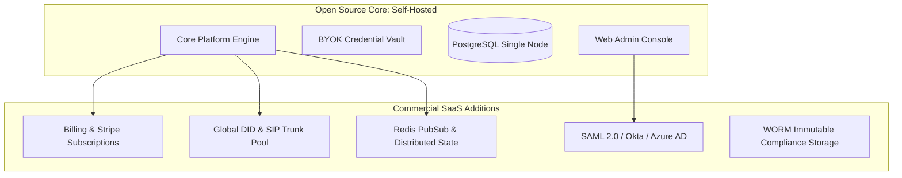

# Commercial Readiness Assessment & Monetization Strategy

This document provides a realistic, production-minded evaluation of the platform's commercial readiness, monetization architecture, operational boundaries, and pathways toward hosted SaaS offerings.

---

## 1. Commercial Onboarding Evaluation

### Current State
- **Self-Service Tenant Creation**: Supported via initial seed or API registration.
- **BYOK Configuration**: Complete. Each tenant enters their own AI provider keys (OpenAI, Anthropic, Gemini, Groq) and Telephony credentials (Twilio Account SID/Token or SIP endpoints) directly via the Web Console at `/integrations`.
- **Zero Financial Liability for Operator**: Because tenants supply their own credentials, the host operator incurs zero direct telephony charges, carrier fees, or LLM token costs.

### Production Enhancements Needed for Commercial SaaS
1. **Automated Tenant Self-Signup**: Add self-service account registration with email verification and multi-factor authentication (MFA).
2. **Interactive Onboarding Wizard**: A step-by-step wizard guiding non-technical business owners through:
   - Entering operating hours and business phone numbers.
   - Uploading initial FAQ documents or pasting knowledge text.
   - Test-calling the assigned number or using the browser simulator.

---

## 2. Usage Metering Interfaces & Billing Boundaries

To support managed hosting, usage tiers, or consumption billing, the platform includes a production metering and subscription engine in `packages/core/src/billing/meter.ts` (`UsageMeter`):

### Metered Dimensions
1. **Telephony Voice Minutes**:
   - Tracked in `call_sessions` via `duration_seconds`.
   - Evaluated against subscription tier quotas (e.g., 500 min for Starter, 3,000 min for Pro, unlimited for Enterprise).
2. **AI Provider Tokens (Prompt & Completion)**:
   - Tracked per conversation turn.
   - Quota evaluated with automatic per-1k token overage calculations.
3. **Active Support Agent Seats**:
   - Tracked in `tenant_memberships` where `role IN ('owner', 'admin', 'agent')`.
   - Enables standard per-seat monthly subscription tiers.
4. **Knowledge Base Storage Chunks**:
   - Tracked in `knowledge_chunks`.
   - Enables storage-based tier enforcement (e.g., Starter: 50 chunks; Pro: 500 chunks; Enterprise: unlimited).

### Subscription Tier Definitions (`UsageMeter`)
- **Starter Plan**: $49/mo base fee, 500 included voice minutes, 100k included AI tokens, $0.05/min voice overage, $0.003/1k token overage.
- **Pro Plan**: $199/mo base fee, 3,000 included voice minutes, 1M included AI tokens, $0.035/min voice overage, $0.002/1k token overage.
- **Enterprise Plan**: Custom base fee, unlimited minutes and tokens with custom SLA and dedicated infrastructure.

---

## 3. Diagnostic Export & Supportability

### Customer-Facing Diagnostic Package
When a customer experiences telephony issues or unexpected AI answers, support teams must be able to diagnose issues without compromising caller privacy.

### Features Implemented:
1. **Customer Data Export**: Implemented in `/api/v1/privacy/export-data?tenantId=...&customerId=...` adhering to GDPR Article 20 requirements.
2. **Audit Trail**: Every state transition, prohibited action rejection, prompt injection detection, and role change is logged to `audit_events`.
3. **Structured Error Codes**: All API and core exceptions carry typed error codes (`AI_RATE_LIMIT`, `CONVERSATION_INVALID_STATE`, `PROHIBITED_ACTION`, `ESCALATION_FAILED`) rather than raw runtime stack traces.

### Recommended Supportability Enhancements:
- **One-Click Support Bundle Generator**: An administrative tool that packages redacted conversation transcripts, latency timestamps, and state machine transitions into an encrypted zip archive for tier-3 debugging.

---

## 4. Hosted-Service Transition Pathway

The open-source core is deliberately structured to enable a frictionless transition to a managed multi-tenant SaaS offering ("CustomerService Cloud"):

### Transition Roadmap:
1. **Phase 1: Self-Hosted BYOK (Current)**:
   - Businesses run their own Docker stack and supply their own API keys and phone trunks.
2. **Phase 2: Managed Hosting (Turnkey SaaS)**:
   - Operator hosts the infrastructure on Kubernetes with managed PostgreSQL.
   - Customers pay a monthly fee per agent seat, bringing their own Twilio/LLM keys.
3. **Phase 3: Full-Service Telephony & AI Bundling**:
   - Operator provides out-of-the-box phone numbers and bundled LLM inference, billing on a unified per-minute or per-conversation basis.

---

## 5. Enterprise Security & Compliance Assessment

| Standard | Status | Implementation Details / Gaps |
| :--- | :--- | :--- |
| **SOC 2 Type II** | Ready for Audit | Strict RBAC, immutable audit logging, AES-256-GCM encryption of credentials at rest, PII redaction in operational logs. |
| **GDPR / CCPA** | Implemented | Right of Access (data export endpoint), Right to be Forgotten (retention purging endpoint), clear caller recording consent flow. |
| **HIPAA** | Requires BAA | Platform architecture supports PHI redaction, but commercial SaaS requires signed Business Associate Agreements with underlying AI and telephony providers. |
| **PCI-DSS** | Compliant by Design | Strict prohibition on storing credit card numbers; regex redaction scrubs cardholder data before persistence or log emission. Prohibited tool list permanently forbids payment execution. |

---

## 6. Real-Time Telephony: Turn-Based Webhooks & Ultra-Low-Latency WebSockets

### 1. Turn-Based TwiML Webhooks
The turn-by-turn voice architecture relies on **TwiML webhooks** (`<Gather input="speech">` and `<Dial>`). This architecture is:
- **Highly reliable**: Standard HTTP request/response model with predictable error handling.
- **Zero daemon footprint**: Requires no high-concurrency streaming servers, GPU infrastructure, or complex binary WebSockets.
- **Broadly compatible**: Works with Twilio, Telnyx, Plivo, and standard PBX CURL/AGI dialplans.

### 2. Bidirectional WebSocket Media Streams & Streaming Speech Engine (Implemented)
For conversational experiences requiring sub-500ms interruptions (barge-in while the AI is mid-sentence), the platform provides:
- **`MediaStreamGateway` & `MediaStreamSession`**: Located in `packages/core/src/telephony/stream.ts`. Ingests base64/binary PCM audio packets, handles `media`, `mark`, and `clear` frames, and cancels in-flight TTS playback instantly upon caller interruption.
- **`SpeechPipeline` & Providers**: Located in `packages/core/src/telephony/speech.ts`. Seamlessly integrates streaming STT (Deepgram Nova-2) and neural TTS (ElevenLabs Flash v2), tested with zero-cost mock providers.

