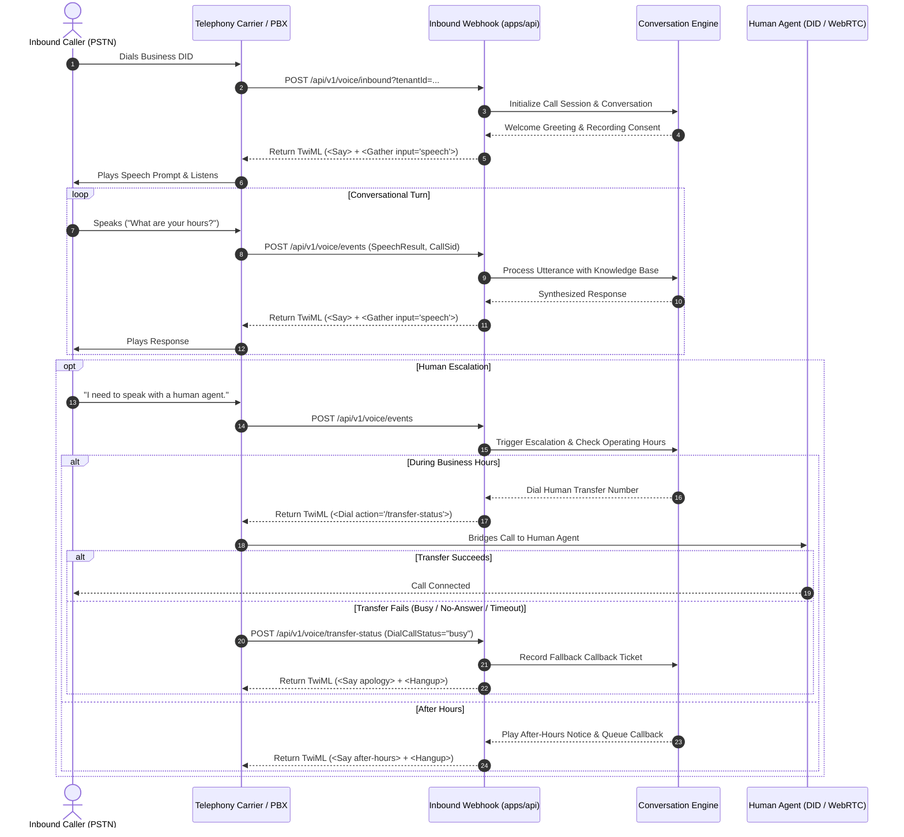
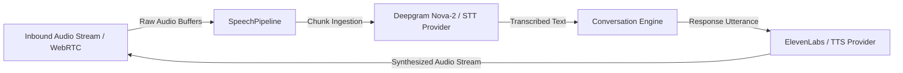

# Telephony Integration & Protocol Guide

This guide details the two telephony deployment models supported by the open-source AI customer-service platform:
1. **Model A**: Provider-Managed Telephony (Twilio, Telnyx, Plivo)
2. **Model B**: Customer-Managed Telephony (Asterisk PBX, FreeSWITCH, SIP Trunks)

---

## 1. Architectural Overview & Inbound Call Flow



---

## 2. Model A: Provider-Managed Telephony (Twilio / Carrier Webhooks)

In Model A, businesses configure webhooks on their managed carrier console pointing to the platform's public API endpoint.

### Webhook Protocol Endpoints

#### 1. Inbound Call Initialization
- **Path**: `POST /api/v1/voice/inbound?tenantId={TENANT_ID}`
- **Carrier Payload Parameters**:
  - `CallSid`: Unique carrier call identifier (e.g. `CA1234567890abcdef`).
  - `From`: Caller E.164 phone number (e.g. `+15551234567`).
  - `To`: Called business E.164 phone number (e.g. `+18005550199`).
- **Response Format**: `text/xml` (TwiML)
- **Sample Output**:
  ```xml
  <?xml version="1.0" encoding="UTF-8"?>
  <Response>
    <Say voice="Polly.Amy">Thank you for calling Acme HVAC. I am an AI assistant. This call may be recorded for quality assurance. How can I help you today?</Say>
    <Gather input="speech" timeout="5" speechTimeout="auto" action="/api/v1/voice/events?tenantId=tenant_acme_hvac_001&amp;callSid=CA1234567890abcdef" method="POST"/>
  </Response>
  ```

#### 2. Speech Gather Event Processing
- **Path**: `POST /api/v1/voice/events?tenantId={TENANT_ID}&callSid={CALL_SID}`
- **Carrier Payload Parameters**:
  - `SpeechResult`: Transcribed text uttered by the caller.
  - `Confidence`: Floating point speech recognition confidence score (`0.0` to `1.0`).
- **Response**: Next conversational turn `<Gather>` or escalation `<Dial>`.

#### 3. Dial Action & Transfer Status Callback
- **Path**: `POST /api/v1/voice/transfer-status?tenantId={TENANT_ID}&callSid={CALL_SID}`
- **Carrier Payload Parameters**:
  - `DialCallStatus`: Status of the transfer bridge (`completed`, `busy`, `no-answer`, `failed`, `canceled`).
  - `DialCallDuration`: Duration in seconds if connected.
- **Handling**:
  - If `completed`: Call ends cleanly with `<Hangup/>`.
  - If `busy` or `no-answer`: Automatically triggers `EscalationEngine` fallback logic, logs a high-priority `callback_request` in PostgreSQL, and speaks an apology to the caller before cleanly hanging up.

---

## 3. Model B: Customer-Managed Telephony (Asterisk & FreeSWITCH)

For enterprises running on-premise PBXs or private SIP trunks:

### Option 1: Asterisk PBX Setup

Configure Asterisk 18+ with PJSIP and an AGI/HTTP webhook script:

#### `pjsip.conf` (Trunk Definition)
```ini
[ai-customer-service-trunk]
type=endpoint
transport=transport-udp
context=inbound-ai-service
disallow=all
allow=ulaw,alaw,opus
aors=ai-customer-service-aor

[ai-customer-service-aor]
type=aor
contact=sip:api.internal.local:5060
```

#### `extensions.conf` (Dialplan Routing)
```ini
[inbound-ai-service]
exten => _+1800555XXXX,1,NoOp(Inbound Call to AI Assistant from ${CALLERID(num)})
 same => n,Answer()
 same => n,Set(CALL_SID=${UNIQUEID})
 same => n,Set(CURL_RESULT=${CURL(http://api:3001/api/v1/voice/inbound?tenantId=tenant_acme_hvac_001,From=${CALLERID(num)}&To=${EXTEN}&CallSid=${CALL_SID})})
 same => n,EAGI(/opt/asterisk/agi/process_twiml.py,${CURL_RESULT})
 same => n,Hangup()
```

### Option 2: FreeSWITCH PBX Setup

FreeSWITCH can dispatch events using `mod_curl` or `mod_audio_fork`:

#### `dialplan/default.xml`
```xml
<extension name="ai_customer_service_inbound">
  <condition field="destination_number" expression="^(555\d{4})$">
    <action application="answer"/>
    <action application="set" data="call_sid=${uuid}"/>
    <action application="curl" data="http://api:3001/api/v1/voice/inbound?tenantId=tenant_acme_hvac_001 post CallSid=${uuid}&amp;From=${caller_id_number}&amp;To=${destination_number}"/>
    <!-- Execute XML actions returned by the API -->
    <action application="lua" data="play_twiml.lua ${curl_response_data}"/>
  </condition>
</extension>
```

---

## 4. Audio Quality, Latency & Codec Recommendations

1. **Carrier Codecs**:
   - G.711u / G.711a (PCMU/PCMA): Default PSTN codecs; universally supported.
   - Opus (Wideband): Highly recommended for SIP trunks and WebRTC; significantly enhances speech recognition accuracy for AI transcription.
2. **Speech Recognition Tuning**:
   - `speechTimeout="auto"` dynamically detects natural conversational pauses without cutting off callers mid-sentence.
   - `timeout="5"` prompts the caller if no speech is detected after 5 seconds.
3. **Barge-in / Speech Interruption Handling**:
   - When a caller speaks while the AI assistant is speaking, `<Gather>` automatically terminates playback and captures the caller's utterance immediately, delivering natural conversational flow.

---

## 5. Offline Call Simulation & Verification

Developers can thoroughly test the full voice call lifecycle, state transitions, speech handling, and transfer failovers without an active phone number or SIP carrier:

```bash
# Run the voice call lifecycle test suite
npm test --workspace=@customer-service/core -- -t "VoiceCallSimulator"
```

The `VoiceCallSimulator` test harness emulates:
1. Inbound call rings and answers.
2. Automated speech recognition (ASR) transcription inputs.
3. Conversational AI reasoning and TTS XML output generation.
4. Human transfer requests.
5. Transfer failure simulation (`busy` / `no-answer`) and verified callback ticket persistence.

---

## 6. Streaming Speech-to-Text & Text-to-Speech Engine

For full-duplex low-latency voice bots, `packages/core/src/telephony/speech.ts` implements a provider-neutral audio processing pipeline:



- **`SttProvider`**: Pluggable interface for streaming speech recognition (`DeepgramSttProvider`, `MockSpeechProvider`).
- **`TtsProvider`**: Pluggable interface for streaming neural voice synthesis (`ElevenLabsTtsProvider`, `MockSpeechProvider`).
- **`SpeechPipeline`**: Coordinates audio chunk buffering, silence detection, utterance transcription events, and automated speech synthesis dispatch.

---

## 7. Contact Center Queues & Automatic Call Distribution (ACD)

When human escalation occurs, `packages/core/src/escalation/queue.ts` provides multi-tenant Automatic Call Distribution (`CallQueueManager`):

- **Priority Tiers**: Enqueues callers by priority (`urgent`, `high`, `normal`, `low`) with timestamp-based FIFO ordering within each tier.
- **Skills-Based Routing**: Matches caller requests with agents possessing matching skill tags (e.g., `['billing', 'hvac-tier2', 'spanish']`).
- **Assignment Strategies**:
  - `longest-idle`: Routes incoming call to the available agent with the earliest `lastCallCompletedAt` timestamp.
  - `round-robin`: Evenly rotates calls across available staff.
- **Abandonment & Queue Metrics**: Tracks real-time active callers, wait times, and caller abandonment (`dequeueCall`).

---

## 8. SMS Messaging Channel

The platform supports conversational SMS interactions via `packages/core/src/messaging/sms.ts` and `POST /api/v1/sms/inbound`:

- **Carrier Inbound Webhook**: Receives standard Twilio SMS webhooks (`From`, `To`, `Body`, `MessageSid`).
- **Customer Identity Resolution**: Looks up or creates customer records using E.164 phone numbers.
- **Unified Engine**: Routes SMS turns through prompt injection defenses, tenant knowledge base BM25 search, and AI synthesis.
- **TwiML Response**: Returns `<Response><Message>{AI Response}</Message></Response>` formatted for concise mobile messaging.

---

## 9. WebRTC In-Browser Agent Softphone

The Next.js agent console (`apps/web/src/app/(dashboard)/conversations/page.tsx`) features an embedded WebRTC softphone interface:

- **Agent Call Bar**: Displays live duplex call status (`Connected`, `On Hold`, `Muted`).
- **One-Click Controls**:
  - **Mute / Unmute**: Toggles local microphone audio input.
  - **Hold / Resume**: Suspends two-way audio stream and plays configured comfort music.
  - **Disconnect**: Ends active call session and logs disposition metrics.
